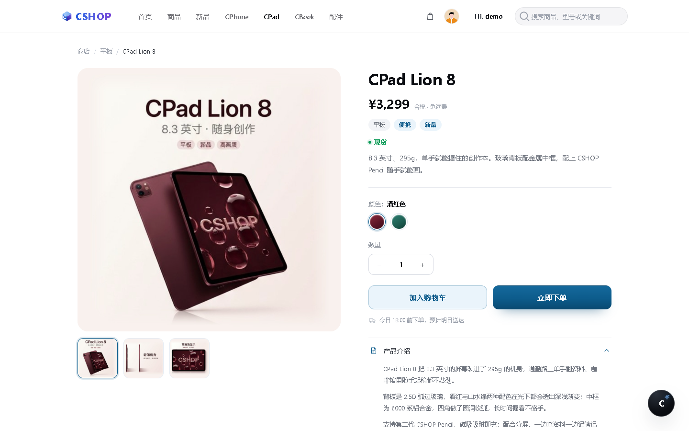
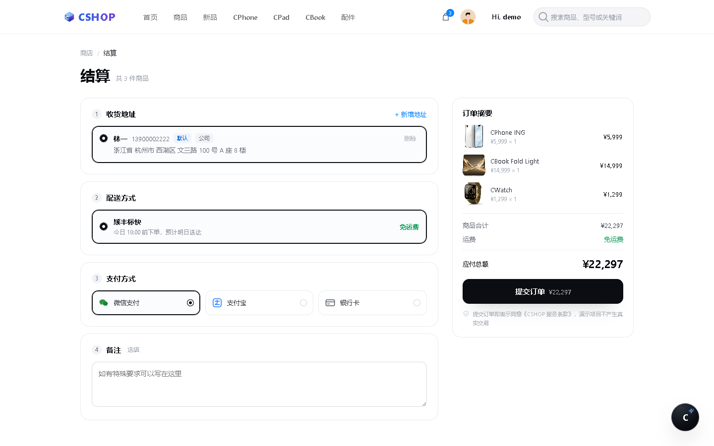
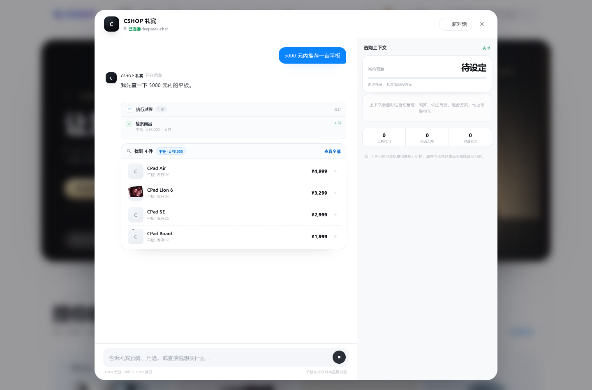

# CSHOP · 让算力在指尖折叠

一个**纯前端 + AI 导购**的 3C 数码电商演示站。覆盖「注册登录 → 浏览商品 → 查看详情 → 加购 → 结算下单 → 查看订单」完整链路，并在全站内置一位能查商品、比价、配组合、直接下单的 AI 礼宾。

**在线体验**：https://cshop-store-60211.app.workbuddy.host/?sharecode=FYIZXEFH3Q
**演示账号**：`demo` / `123456`（也可自行注册，支持手机号或邮箱）

---

## 目录

- [项目介绍](#项目介绍)
- [界面预览](#界面预览)
- [技术栈](#技术栈)
- [AI Coding Process](#ai-coding-process)
- [项目结构](#项目结构)
- [本地运行](#本地运行)
- [数据与隐私](#数据与隐私)

---

## 项目介绍

### 它是什么

一个面向 3C 数码品类（手机 / 平板 / 笔记本 / 配件）的电商前台演示项目。没有使用任何前端框架，也没有构建步骤，全部由原生 HTML / CSS / JavaScript 实现，数据保存在浏览器本地，克隆下来起一个静态服务即可完整运行。

在「商品浏览 + 交易闭环」这条常规主线之外，项目还实现了一个**真正可用的 AI 导购助手**——它不是摆设式的对话框，而是接入了 10 个业务工具，能实际检索商品、比较参数、按预算搭组合、把商品加进购物车、甚至走完下单流程。

### 解决什么问题

| 常规电商演示站的问题 | 本项目的做法 |
| --- | --- |
| 只有列表和详情，购物车是假的 | 购物车有完整状态管理：库存上限、跨标签同步、持久化、两段确认清空 |
| 结算页只有一个按钮 | 地址簿打通个人中心、三种支付方式（两种扫码 + 银行卡表单）、下单后生成可回看的订单 |
| 商品详情用同一张图套所有机型 | 5 款商品各有独立详情页，图片按海报三段拆分，其中 2 款支持配色实时切换 |
| AI 只是聊天窗口，答完就结束 | AI 直接调用业务工具，说完就能把商品加进购物车、生成订单 |

### 功能地图

| 模块 | 能力 |
| --- | --- |
| 账号 | 手机号 / 邮箱登录注册、密码强度与一致性校验、登录态持久化、未登录拦截 |
| 导航 | 7 个一级栏目、数据驱动的分类下拉、高亮跟随页面、搜索（回车与点击图标等效）、购物车角标、问候语与悬浮菜单 |
| 首页 | 双屏轮播（5 秒自动 + 手动切换 + 进度条）、分类入口四卡、新品探寻、品牌故事、精选产品 |
| 商品列表 | 全部 / 分类 / 新品 / 关键词四种视图、搜索结果显示专属标题、每个分类页一张专属广告牌 |
| 商品详情 | 5 款商品、图库（大图 + 缩略图）、双按钮、数量与库存联动、2 款支持双色切换、四组折叠信息 |
| 购物车 | 侧拉抽屉、加购 / 改量 / 移除 / 单项小计 / 合计 / 清空、库存上限、跨标签页同步 |
| 结算 | 单页结算、地址选择与页内新增、三种支付、立即下单（直购）与购物车结算双通道 |
| 订单 | 下单成功页（含精确到秒的下单时间）、个人中心订单列表（准备发货状态） |
| AI 礼宾 | 10 个业务工具、流式回复、执行过程可视化、选购上下文面板、写操作二次确认 |

---

## 界面预览

| 首页 · 双屏轮播 | 分类页 · 专属广告牌 |
| --- | --- |
|  |  |

| 商品详情 · 双色切换 | 购物车 · 侧拉抽屉 |
| --- | --- |
|  |  |

| 结算页 | 个人中心 |
| --- | --- |
|  |  |

**AI 礼宾**：说出预算或用途，它会自动检索商品并给出选择



---

## 技术栈

### 前端

| 分类 | 选型 | 说明 |
| --- | --- | --- |
| 结构 | 原生 HTML5，8 个页面 | 无 SPA 路由，多页面跳转，URL 参数驱动视图（`?cat=` / `?q=` / `?new=` / `?id=`） |
| 样式 | 原生 CSS，13 个样式文件 | CSS 变量统一色板；布局用 Grid / Flex；`clamp()` 做流体字号；无预处理器 |
| 脚本 | 原生 ES5+，18 个脚本文件 | 无框架、无打包、无依赖，全部通过 `<script>` 直接引入 |
| 图标 | 内联 SVG | 不依赖图标库或字体，避免额外请求 |
| 图片处理 | Canvas 2D + Playwright 脚本 | 用于商品图的裁切、白平衡、羽化合成与配色变换 |

**为什么不用框架**：项目要交付的是一个「打开就能跑、换台电脑也能跑」的静态站点，没有 Node 环境依赖。用原生实现反而让体积、加载路径、部署方式都最可控——整站 10 MB，其中 9 MB 是商品图。

### 数据层

| 机制 | 实现 |
| --- | --- |
| 用户与会话 | `localStorage`：`cshop_users_v`（账号表）、`cshop_session_v`（登录态） |
| 购物车 | `cshop_cart`，自建发布订阅：`commit()` 统一「写盘 → 重渲染 → 通知订阅者」，导航角标订阅更新；监听 `storage` 事件实现跨标签页同步 |
| 订单 | `cshop_orders_<账号>`，最新在前，保留最近 30 单 |
| 直购通道 | `cshop_buynow`（sessionStorage），详情页「立即下单」专用，不污染购物车 |
| 地址数据 | 内置 `js/regions.js`（约 88 KB 省市区三级数据），离线可用 |

### AI

| 层 | 实现 |
| --- | --- |
| 模型 | DeepSeek Chat（`deepseek-chat`），开启 `stream` 与 `stream_options.include_usage` |
| 代理 | `server/ai-proxy.js`，仅用 Node 内置模块（`http` / `https` / `fs`），零第三方依赖 |
| 密钥 | API Key 只存服务端 `.env`，前端永远拿不到 |
| 流式 | 上游 SSE 逐块转发给浏览器；前端边收边渲染，支持中断 |
| 工具调用 | Function Calling，10 个工具：6 个只读（`searchProducts` / `getProduct` / `compareProducts` / `buildBundle` / `getCart` / `listAddresses`）+ 4 个写操作（`addToCart` / `updateCartItem` / `removeFromCart` / `createOrder`），写操作必须用户确认后执行 |
| 端点切换 | `js/ai-endpoint.js` 按域名注入端点：本地指向 `127.0.0.1:8126`，线上指向反向隧道地址 |
| 降级 | 连不上代理时显示「未连接代理」并给出启动命令，不阻塞主站任何功能 |

### 开发期工具（不参与打包）

- **Playwright**：每次改动后自动跑回归——登录、轮播切换、加购、结算、下单、响应式断点，捕获 404 与 JS 报错
- **Canvas 脚本**：商品图批处理（白点归一、边羽化、色相偏移、主体包围盒裁切）
- **Git**：源码版本管理；`dist/` 为发布产物，不入库

---

## AI Coding Process

本项目全程与 AI 编程助手协作完成，其中两个 AI 环境（WorkBuddy 与 Qoder）接力推进：前者负责工程骨架、交易闭环与大部分视觉改造，后者补充了分类广告牌体系、首页编辑风区块和 AI 礼宾模块。

下面选三个有代表性的任务，说明 AI 在其中的实际作用、遇到的问题，以及人是如何介入判断的。

### 任务一：首屏从浅色卡片改造成深金双屏轮播

**背景**：首页首屏原先是浅灰渐变卡片 + 两个 SVG 线稿产品图，与「高端 3C」的定位不匹配。目标是参考一张深色海报，把首屏改成深金质感，右侧换成折叠本实拍级主视觉；随后又要求加入第二屏（手机）并做成 5 秒轮播。

**AI 的参与方式**

1. **图像生成**：用结构化提示词描述构图约束（产品落在右三分之一、左侧留大面积暗部给文案、无水印、无文字、16:9），两张参考图作为风格输入，生成 1536×1024 主视觉。
2. **融合方案**：生成图与卡片背景之间有可见的矩形边界。AI 提出并实现了两套策略——桌面双栏下把图片放大到越界（右 / 上 / 下三边被卡片裁掉，只剩左缘用渐变遮罩淡出）；单列布局下干脆不用图片元素，直接把图设为卡片背景并叠加顶部暗化，从根上消除接缝。
3. **轮播实现**：两屏放入 flex 轨道，`translateX` 位移切换，0.92 秒缓动；非当前屏的文案与产品图额外位移并降透明度，形成层次感。切换按钮内嵌进度条，与计时同步。

**遇到的坑与纠偏**

| 问题 | 处理 |
| --- | --- |
| 生成图右下角带 AI 水印 | 分析水印位置后裁到 918 高，刚好切掉水印且保留完整机身与倒影 |
| 平板宽度下单列图片仍有硬边 | 放弃「图片元素 + 遮罩」，改为卡片 `background-image`，彻底没有边界 |
| 手机端文字与产品图重叠 | 改为上下结构：文字在上，图片满宽贴底，上下双向羽化 |
| 系统开启「减少动态效果」后轮播完全不动 | 定位到早期实现把自动播放也一起关了；改为只关闭过渡动画，保留 5 秒计时 |
| 首屏切到后台再回来时间错乱 | 监听 `visibilitychange`，切走暂停、回来重启计时 |

**人的判断点**：图片裁切高度（要刚好切掉水印又不切机身）、遮罩方向与羽化幅度、停留时长从 10 秒改 5 秒、右上角标从「双产品名」简化为单个产品名并放大字号——这些都是审美判断，AI 给出方案与实现，人来定夺。

---

### 任务二：五款商品详情图的三段裁切与配色变换

**背景**：五款商品的原素材都是同一格式的竖版长海报（768×1376），每张包含「主视觉 / 细节 / 特写」三段文案。详情页需要三张方形图，且**必须保留海报上的所有文字**；其中 CPad Lion 8 与 CWatch 还要支持双色切换。

**AI 的参与方式**

1. **分段裁切**：AI 先输出候选裁剪框，逐段截图给人确认边界，再写入批处理脚本；裁切起点会主动避开段间的灰色分隔线（否则细线会横在图片上沿）。
2. **底色归一**：三段的底色并不一致（偏白 / 偏粉 / 偏灰），直接拼进方形画板会露出色块。方案是先把每段白点按通道乘以增益拉到统一底色，再合成、再羽化，三张图切换时不会「跳色调」。
3. **边羽化**：只对图片自己的四条边做渐隐，画面四周融进画板，看不到矩形。
4. **配色变换**：不做整图滤镜，而是按「色相区间 + 色度」双门槛筛选像素再偏移色相——酒红转青绿偏移 180°，曙光金转甜美粉只作用于金色色相带。

**遇到的坑与纠偏**

| 问题 | 处理 |
| --- | --- |
| 第一版为了避开文字把三段裁得很紧，标题、价格、标签全被切掉 | 用户明确要求「图片里的文字不要删」，改为整段裁切、只收左右空白边 |
| 换色后**整张图泛绿**，连浅色背景都被染色 | 根因是用 HSL 饱和度做权重——近白色像素的 HSL 饱和度会算出 0.4 以上。改用色度 `(max-min)/255` 做双门槛（<0.05 不动，>0.11 全换） |
| 耳机头梁在原海报里就被分隔线切断，裁出来像被硬切 | 单独把顶边淡出放大到 26% 高度，让部件「渐隐消失」而不是「齐刷刷截断」 |
| 缩略图里手机只有指甲盖大 | 缩略图单独出图：按与底色的差异求主体包围盒，再方形裁切放大 1.12 倍 |
| 详情页数据 key 写成 `cpad-lion-8`，点卡片不跳转 | 商品真实 id 是 `cpad-mini-8`；AI 自查发现并修正，之后统一以 `products.js` 的 id 为准 |

**人的判断点**：每段裁剪边界是否切到文案、羽化多少才自然、粉色版的色相偏移量是否偏紫——这些都需要人眼看图确认，AI 负责快速产出候选并迭代。

---

### 任务三：CSHOP 礼宾（AI 导购助手）

**背景**：站点已有完整商品与交易数据，希望加一个能真正参与购物的助手，而不是只会闲聊的对话框。要求：能按预算 / 用途推荐、能对比、能加购、能下单，且 API Key 不能出现在前端。

**AI 的参与方式**

1. **能力拆分**：先把「导购要做什么」翻译成 10 个工具，明确哪些只读、哪些会改变用户数据。写操作（加购、改数量、移除、下单）全部标记为需确认，模型只能提出、不能直接执行。
2. **后端代理**：`server/ai-proxy.js` 只做三件事——转发对话、把 SSE 流原样透传、提供健康检查。Key 从 `.env` 读取，永不下发；内置请求体大小与消息条数上限、上游超时、CORS 白名单。
3. **前端交互**：流式渲染（边收边出字）、执行过程卡片（显示调用了哪个工具、耗时、结果条数）、右侧「选购上下文」实时显示预算、购物车件数、工具调用与方案生成次数。
4. **降级设计**：健康检查失败时，面板照常打开，显示「未连接本地代理」与启动命令，主站其他功能完全不受影响。

**遇到的坑与纠偏**

| 问题 | 处理 |
| --- | --- |
| 静态托管跑不了 Node，线上助手一律「未连接」 | 新增 `js/ai-endpoint.js`：非 localhost 时注入反向隧道地址；同时把线上域名加进服务端 CORS 白名单 |
| 隧道每次重启域名就变，线上悄悄失效 | 端点集中在单个文件里，改一行再发布即可；README 与交付说明都记录了这条运维前提 |
| 模型可能「先斩后奏」直接改购物车 | 写工具加确认闸门：未确认时返回 `CONFIRM_REQUIRED`，由前端弹确认卡 |
| 流式输出中途断开，界面卡在「正在回复」 | 前端按 SSE 事件逐段收尾，异常时收敛为错误提示而非一直转圈 |

**人的判断点**：工具粒度的划分（太粗模型不会用，太细调用次数爆炸）、哪些操作必须确认、执行过程要暴露到什么程度、离线时提示文案怎么写——这些是产品判断，AI 提供实现与备选。

### 协作方式小结

| 环节 | 做法 |
| --- | --- |
| 需求拆解 | 由人给出目标与参考图，AI 拆成可验证的小步，逐步交付 |
| 改动验证 | 每次改动都用 Playwright 跑一遍相关路径，检查 404、JS 报错、横向溢出、断点表现，避免「改 A 崩 B」 |
| 视觉迭代 | AI 生成候选 → 截图给人看 → 人指出具体问题（边界、字号、间距）→ 定点修，通常 2–4 轮收敛 |
| 问题定位 | 遇到「看起来没生效」先取证（响应头、缓存状态、版本号串），再改代码，而不是反复重试 |
| 边界情况 | 库存上限、空购物车、无效 id、跨标签页、断网降级等，都在实现时一并处理并测试 |

---

## 项目结构

```
shop/
├── index.html              首页（双屏轮播、分类入口、新品、品牌故事、精选）
├── products.html           商品列表（分类 / 新品 / 搜索）
├── product.html            商品详情（图库、双按钮、折叠信息）
├── checkout.html           结算（地址、配送、支付、备注、摘要）
├── order.html              下单成功 / 订单详情
├── profile.html            个人中心（资料、我的订单、收货地址）
├── login.html / register.html
│
├── css/
│   ├── style.css           全局变量与基础样式
│   ├── home.css            导航、首屏、商品卡、区块
│   ├── product.css         详情页
│   ├── checkout.css        结算与订单页
│   ├── profile.css         个人中心
│   ├── cart.css            侧拉购物车
│   ├── editorial.css       首页编辑风区块
│   ├── billboard.css       通用广告牌
│   ├── cpad-billboard.css  ┐
│   ├── cbook-billboard.css │ 各分类专属广告牌
│   ├── cmaxing-billboard.css
│   ├── new-arrivals-billboard.css
│   └── assistant.css       AI 礼宾
│
├── js/
│   ├── products.js         商品数据（21 件）与卡片渲染
│   ├── auth.js             账号、会话、地址簿
│   ├── regions.js          省市区三级数据
│   ├── nav.js              导航、下拉、角标、问候语
│   ├── home.js             首页交互与搜索
│   ├── hero-slider.js      首页双屏轮播
│   ├── all-products.js     列表筛选与搜索
│   ├── product-detail.js   详情页（含 5 款详细数据）
│   ├── cart.js             购物车状态与抽屉
│   ├── orders.js           订单读写
│   ├── checkout.js         结算流程
│   ├── order.js            下单成功页
│   ├── profile.js          个人中心
│   ├── login.js / register.js
│   ├── assistant.js        AI 礼宾界面与流式渲染
│   ├── assistant-tools.js  10 个业务工具定义与执行
│   └── ai-endpoint.js      端点注入（本地 / 线上）
│
├── server/
│   ├── ai-proxy.js         DeepSeek 代理（SSE 转发、Key 隔离、CORS）
│   └── mock-ai.js          无 Key 时的脚本回复，用于界面联调
│
├── assets/
│   ├── products/           商品图（含 5 款详情图目录）
│   ├── billboard/          广告牌视觉素材
│   └── home/               首屏主视觉
│
└── docs/
    ├── 项目工作总结.md
    └── screenshots/        README 截图
```

---

## 本地运行

### 只看主站（不需要 AI）

项目无构建、无 npm 依赖，任意静态服务器即可：

```bash
python -m http.server 8000
# 打开 http://localhost:8000/login.html
```

> 建议用 `http://` 而不是双击 `index.html`：部分浏览器在 `file://` 下会限制 `localStorage`，登录态无法保存。

### 启用 AI 礼宾（可选）

1. 复制配置并填入 Key：

```bash
cp .env.example .env
# 编辑 .env，填写 DEEPSEEK_API_KEY
```

2. 启动本地代理：

```bash
node server/ai-proxy.js
# 健康检查：http://127.0.0.1:8126/api/health
```

3. 用静态服务器打开站点，右下角「C」按钮即可对话。

若暂时没有 Key，可在 `.env` 里设 `AI_MOCK=1` 启动，走本地脚本回复，能验证流式输出、工具调用与确认卡的界面链路。

### 部署到线上

前端是纯静态文件，可直接托管。若要让线上的 AI 也能用，需要把 `ai-proxy.js` 部署到能运行 Node 的地址，然后修改 `js/ai-endpoint.js` 里的端点指向它，并把该站点域名加入 `AI_ALLOWED_ORIGINS`。

---

## 数据与隐私

- 所有用户数据（账号、地址、购物车、订单、AI 对话记录）都保存在**访问者自己的浏览器**，不上传任何服务器
- `server/ai-proxy.js` 只转发对话内容给 DeepSeek，不落库、不记录日志
- API Key 仅存于服务端 `.env`（已在 `.gitignore` 中排除，仓库内只有 `.env.example` 占位）
- 商品图由 AI 生成 + 后期处理，价格与参数为演示用虚构数据，不代表真实销售信息

---

> 本项目为课程作业，仅用于教学与演示，不含任何商业用途。
