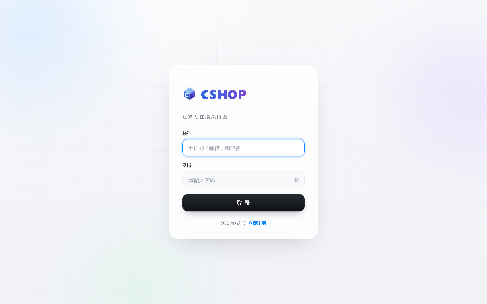
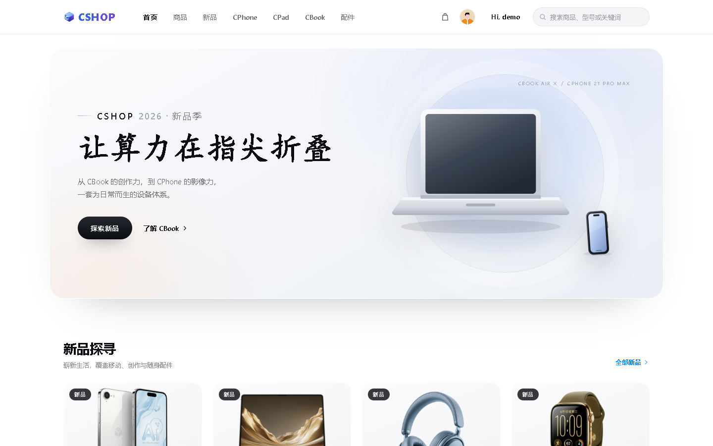
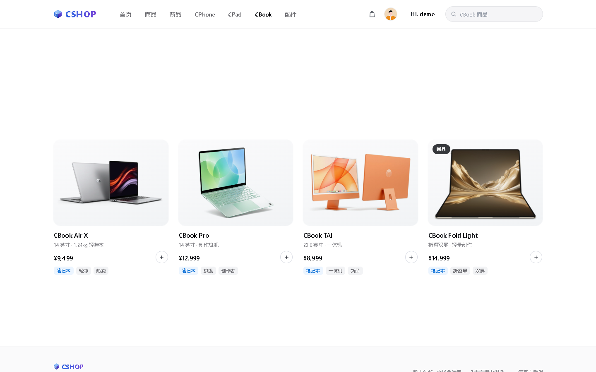
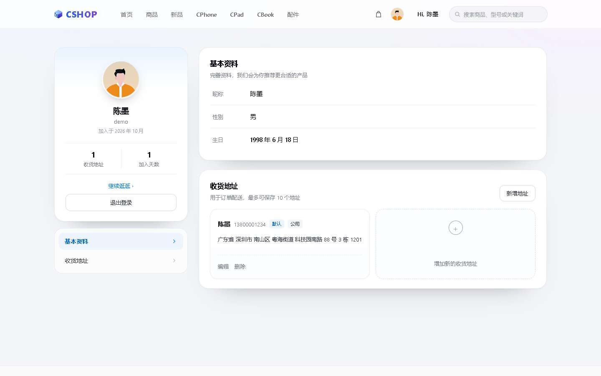
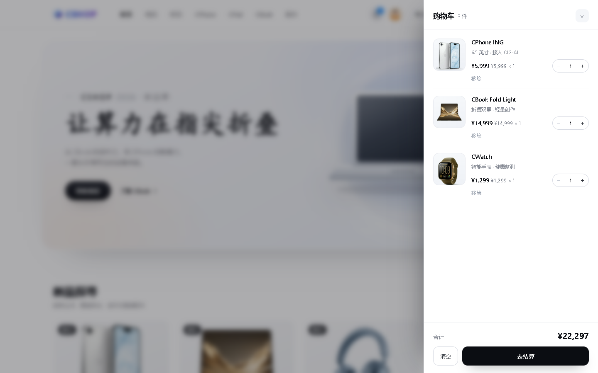

# CSHOP · 让算力在指尖折叠

一个**纯前端**的 3C 数码电商网站演示项目（笔记本 / 手机 / 平板 / 配件）。
包含登录注册、首页、分类商品页、个人中心、侧拉购物车等完整流程，**不需要后端和数据库**，打开在线链接即可体验。

---

## 目录

- [这是什么](#这是什么)
- [快速开始](#快速开始)
- [页面截图](#页面截图)
- [功能清单](#功能清单)
- [技术实现](#技术实现)
- [目录结构](#目录结构)
- [数据说明](#数据说明)

---

## 这是什么

CSHOP 是一个模拟品牌官网的电商前端项目。它把「**逛 → 选 → 加购 → 结账**」这条主流程做完整，同时在视觉上采用浅色极简 + 大留白的品牌官网风格，而不是常见的后台模板风。

适合用来：

- 课程作业 / 项目考核的完整前端作品展示
- 学习原生 JavaScript 的**状态管理与组件化**写法（无框架依赖）
- 参考「商品图统一处理 + 设计系统」如何落地到具体页面

## 快速开始

**在线访问**

👉 <https://cshop-store-60211.app.workbuddy.host/?sharecode=FYIZXEFH3Q>

打开后会自动跳转到登录页，用下面的演示账号登录即可体验完整流程。

**演示账号**

| 账号 | 密码 |
| --- | --- |
| `demo` | `123456` |

也可以自行注册（支持手机号或邮箱注册，注册时会校验密码强度与两次输入是否一致）。

## 页面截图

**登录页**



**首页（品牌区 + 新品推荐）**



**商品列表（按分类浏览）**



**个人中心（资料编辑 + 收货地址）**



**侧拉购物车**



## 功能清单

### 账号

| 功能 | 说明 |
| --- | --- |
| 登录校验 | 账号密码匹配才可进入，错误时给出红字提示 |
| 注册 | 手机号 / 邮箱两种方式，密码强度校验、二次确认密码 |
| 头像与性别 | 注册时可选头像与性别，头像会影响导航栏显示 |
| 登录态保护 | 未登录访问任意页面自动跳回登录页 |

### 首页与导航

| 功能 | 说明 |
| --- | --- |
| 顶部导航 | `首页 / 商品 / 新品 / CPhone / CPad / CBook / 配件`，当前栏目自动加粗 |
| 分类下拉 | 悬停展开分类目录，目录内容由商品数据实时生成，点击型号直接搜索到该商品 |
| 新品试探寻 | 固定展示 4 款主推新品 |
| 精选产品 | 跨品类精选，点击进入对应商品 |
| 搜索 | 输入即联想（缓存结果面板），回车跳转到结果页 |
| 问候语 | 头像右侧显示 `Hi, 昵称`，点击进入个人中心 |

### 商品浏览

| 功能 | 说明 |
| --- | --- |
| 商品卡 | 图片、名称、简介、价格、品类与标签、新品角标、库存状态 |
| 分类筛选 | 通过导航栏直达对应分类页（`?cat=`），也可用搜索定位单品（`?q=`） |
| 搜索 | 支持商品名、简介、标签、关键词多字段匹配 |
| 空状态 | 无结果时给出提示与重置入口 |
| 补货中 | 缺货商品显示灰色遮罩与「补货中」，且不可加购 |

### 个人中心

| 功能 | 说明 |
| --- | --- |
| 基本资料 | 昵称（弹层编辑，同步到导航栏）、性别、生日（未填时显示「填写生日解锁生日福利」） |
| 收货地址 | 增删改查，省 → 市 → 区三级联动，街道与门牌号分开填写，支持家 / 公司 / 学校标签与默认地址 |
| 数据统计 | 收货地址数量、加入天数 |
| 账户操作 | 页内退出登录 |

### 购物车

| 功能 | 说明 |
| --- | --- |
| 侧拉抽屉 | 点击导航购物车图标从右侧滑出，遮罩模糊，Esc / 点遮罩 / × 关闭 |
| 加购 | 商品卡右下角「+」按钮，Toast 反馈 + 导航角标实时跳动 |
| 修改数量 | 步进器增减，数量 1 时减号禁用，达到库存上限时加号禁用 |
| 金额计算 | 单项小计（单价 × 数量）与购物车合计实时更新 |
| 删除 / 清空 | 单项移除；清空需二次确认（按钮变为「确认清空」，2.6 秒后自动复位） |
| 状态持久化 | 刷新、跳页、重开浏览器都不丢；多标签页之间自动同步 |
| 数据校验 | 已下架商品自动剔除、重复商品合并数量、数量夹在 `1 ~ min(99, 库存)` |

### 界面

- 浅色极简设计系统（统一色板、圆角、投影、字号层级）
- 响应式：桌面双栏 / 平板自适应 / 手机单列，购物车在手机端为全屏
- 商品图统一处理：白底提纯、包围盒裁切、锐化，与卡片背景无缝融合
- 交互细节：滚动进场动画、悬停反馈、弹层焦点管理、Toast 提示

## 技术实现

| 项 | 说明 |
| --- | --- |
| 技术栈 | 原生 HTML + CSS + JavaScript（ES5 语法风格），无框架、无构建、无外部 CDN |
| 状态管理 | 自建轻量发布/订阅：`subscribe(fn)` 订阅、每次变更统一 `commit()`（写盘 → 重渲染 → 通知） |
| 持久化 | `localStorage`：账号、个人资料、收货地址、购物车 |
| 多标签同步 | 监听 `storage` 事件，其它标签页的角标与列表自动更新 |
| 数据模块 | `js/products.js` 统一提供商品数据、搜索、卡片渲染、价格格式化 |
| 行政区划 | 国家统计局 2019 年数据（经 `china-area-data` 整理），34 个省级行政区、省市区三级，内置为 `js/regions.js` |
| 兼容性 | Chrome / Edge / Safari / Firefox 最新版；移动端 iOS Safari、Android Chrome |

**为什么不用框架**：项目定位是展示「原生实现一个完整电商前端」的能力，因此所有状态管理、事件委托、弹层与动画都手写，代码量可控且无依赖，克隆即可运行。

## 目录结构

```
.
├── index.html            # 首页
├── products.html         # 商品列表 / 分类 / 搜索 / 新品
├── profile.html          # 个人中心
├── login.html            # 登录
├── register.html         # 注册
├── css/
│   ├── style.css         # 设计系统基础（色板、字体、通用组件）
│   ├── home.css          # 导航、首页、商品卡、页脚
│   ├── profile.css       # 个人中心
│   └── cart.css          # 购物车抽屉
├── js/
│   ├── auth.js           # 账号、登录态、资料、收货地址
│   ├── products.js       # 商品数据与卡片渲染
│   ├── cart.js           # 购物车状态 + 抽屉界面
│   ├── nav.js            # 公共导航：问候语、下拉、角标、高亮
│   ├── home.js           # 首页渲染与搜索面板
│   ├── all-products.js   # 商品列表页筛选与搜索
│   ├── profile.js        # 个人中心交互
│   ├── login.js          # 登录页
│   ├── register.js       # 注册页
│   └── regions.js        # 省市区数据
├── assets/
│   ├── products/         # 26 张商品图
│   ├── avatars/          # 默认头像
│   ├── favicon.svg
│   └── logo-cube.svg
├── docs/
│   └── screenshots/      # README 截图
└── README.md
```

## 数据说明

- 商品共 **21 件**：手机 6 款、平板 4 款、笔记本 4 款、配件 7 款（耳机 3、充电 2、手表 1、充电宝 1）
- 商品图由 AI 生成后统一处理（去背景、裁切、锐化），仅用于课程演示，非真实商品
- 账号、地址、购物车等数据都保存在**浏览器本地**，换电脑或清理浏览器数据后会重置
- 内置演示账号 `demo / 123456` 会在首次打开时自动创建

---

> 本项目为课程作业，仅用于教学与演示，不含任何商业用途。
